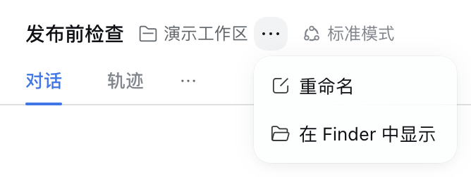
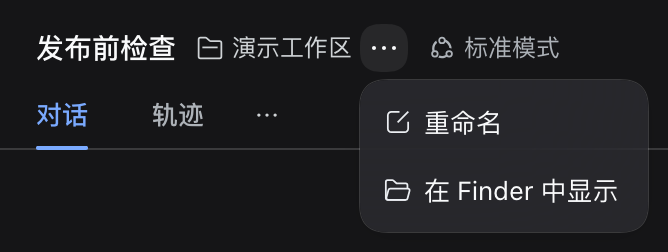

# @miorin/dsh-workspace-title-badge

[简体中文](README.zh.md)

Displays each session's workspace name beside its title in flat-list mode, with an ellipsis
and right-click menu exposing workspace actions without **Delete**.

- Uses the sidebar's folder icon and default-name localization (`default-workspace`);
  automatically steps aside in grouped sidebar views and standalone sessions.
- Requires DeepSeek Harness `0.2.2-rc.3` or newer.
  Included in **Workspace Modular Improvement Plan** (`@miorin/dsh-atlas-workspace`); install either one, never both.
- Standalone install: run `pnpm install --frozen-lockfile` in this directory and select it
  in **Plugins → Add plugin** (or via `plugin_manager`).

## Screenshots

The screenshots show the Chinese interface.

| | Light | Dark |
| --- | --- | --- |
| Label and ellipsis |  |  |
| Workspace menu |  |  |

[Menu design](docs/workspace-menu.md) · [Project documentation](docs/README.md)
