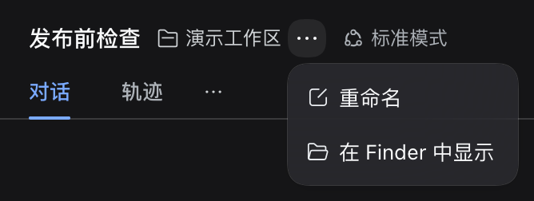

# @miorin/dsh-workspace-title-badge

[English](README.md)

在侧栏单列表模式下于会话标题旁显示所属工作区名，悬停展开省略号或右键即可打开不含 **删除** 的工作区操作菜单。

- 沿用侧栏文件夹图标与 `default-workspace` 默认名本地化；在按工作区分组视图或无工作区归属的会话中自动隐藏。
- 需要 DeepSeek Harness `0.2.2-rc.3` 或更新版本。
  本插件已包含于 **工作区模块化改良计划**（`@miorin/dsh-atlas-workspace`），两者请勿同时安装。
- 单独安装：在本目录运行 `pnpm install --frozen-lockfile` 后，
  从 **插件 → 添加插件** 选择本目录（或通过 `plugin_manager` 安装）。

## 实拍截图

| | 浅色 | 深色 |
| --- | --- | --- |
| 工作区标签与省略号 |  |  |
| 工作区菜单 |  |  |

[菜单设计](docs/workspace-menu.md) · [项目文档](docs/README.md)
